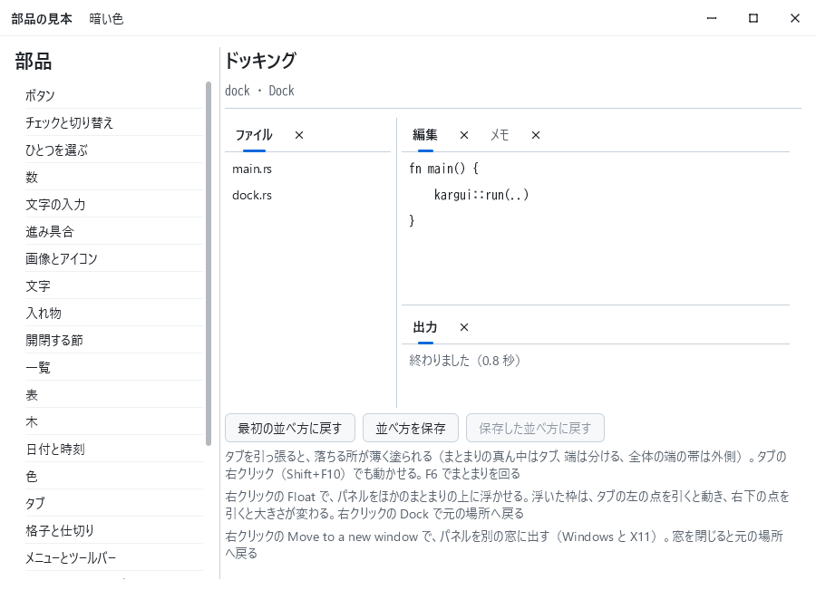
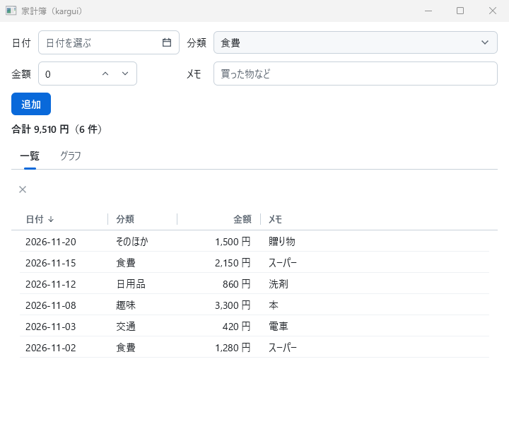
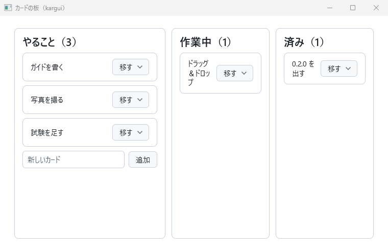
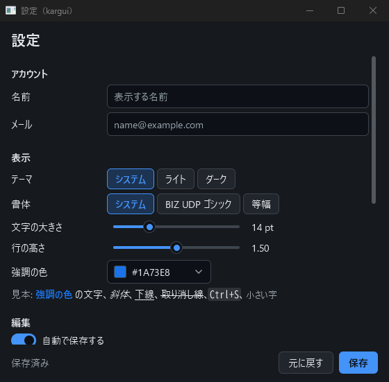

# kargui

Rust で書く、軽いネイティブ GUI フレームワーク（Windows 10/11 と Linux。版は 0.4）。名前は「軽い」「Rust」「GUI」から。[English README](README.md)（この文の訳）。

<p align="center">
  <picture>
    <source media="(prefers-color-scheme: dark)" srcset="https://raw.githubusercontent.com/dikmri/kargui/main/docs/readme/gallery-dark.png">
    
  </picture>
</p>

<p align="center"><sub>部品の見本（<code>examples/gallery</code>、Windows 11）。題の帯・ドッキングのパネル・部品は、どれも kargui が描いている。OS の明暗に合わせて変わる。</sub></p>

| 家計簿（`examples/expenses`） | カードの板（`examples/board`） | 設定（`examples/settings`） |
|:---:|:---:|:---:|
|  |  |  |

Tauri・egui・GPUI で同じアプリ（タスク帳）を作って比べた実験（[AI コーディングノートの実験レポート番外編](https://dikmri.github.io/ai-coding-notes/reports/rust-gui/)）から生まれた。3 つにはそれぞれ優れた所がある。egui は書きやすく、GPUI はメモリが少なく、Tauri は GPU が無い PC でも滑らかに描く。kargui はそれらを 1 つにまとめることを目指し、前回と同じ道具・同じ条件で測りながら作っている。作った過程は[実験レポート番外編 2](https://dikmri.github.io/ai-coding-notes/reports/kargui/)にまとめた。3 つのフレームワークと、その作者・貢献者から多くを学んだ。

## 特徴

- **即時モードの書き方。** 状態は自分の構造体に持ち、`view` で毎回画面全体を書く（egui と同じ書きやすさ）。
- **変わった所だけ描く。** 中で前の画面と比べ、既定の CPU の道で変わった所だけを描き直す。待機中は CPU を使わない。GPU の無い PC でも速い。
- **日本語入力。** 変換を確定する Enter で送信しない、変換中は値を変えない、文節ごとの下線、候補の窓を文字の真下に出す、焦点を移しても変換中の文字を失わない。
- **読み上げとキーボード。** AccessKit で全部の部品を UI オートメーションに渡す。名前の無い部品は記録で警告する。Tab で全部に届く。
- **説明が古くならない。** 公開項目すべてに説明と動く例があり、ガイドのコードも試験で動かす。API が変わったのにガイドを直していないと、検査で落ちる。

## 部品

見出し・ラベル（折り返し、大きさ、右寄せ）・ボタン・チェック・スイッチ・ダークモードのスイッチ・選択（segmented）・入力欄・スライダー・一覧（見えている行だけ作る、行の選択、行を id で区別）・スクロールの入れ物。並べ方は行・列・重ね・残りを分ける（2 回で決める配置）。写真は [docs/widgets.md](docs/widgets.md)。

```rust,no_run
use kargui::{App, Options, Ui};

struct Counter {
    count: u32,
}

impl App for Counter {
    fn view(&mut self, ui: &mut Ui) {
        ui.row(|ui| {
            ui.label(format!("回数: {}", self.count));
            if ui.button("1 足す").clicked() {
                self.count += 1;
            }
        });
    }
}

fn main() {
    kargui::run(Options::new("数える"), Counter { count: 0 }).unwrap();
}
```

## 測った数字（タスク帳。前回の比べと同じ道具・同じ PC）

| 項目 | kargui（CPU の道） | Tauri・egui・GPUI の最良 | 目標 |
|---|---|---|---|
| 起動（空の一覧） | 42 ms | 344 ms（egui、glow） | 330 ms |
| メモリ（1 万件・待機） | 5.4 MB | 17.9 MB（GPUI） | 12.5 MB |
| スクロール中の 1 フレームの CPU（測定の道具） | 0.36 ms | 1.97 ms（egui） | 1.2 ms |
| 待機中の CPU | 0 | 0（egui） | 0.16% |
| 実行ファイルの大きさ | 1.0 MB | 6.7 MB（egui） | 4.5 MB |
| タスク帳の画面のコード | 198 行 | 316 行（egui） | 220 行 |

測定の道具は CPU の時間を 15.6 ms 単位で数えるので、1 ms 前後の 1 フレームの値は回ごとにばらつく。kargui 自身の時計では、スクロール中の 1 フレームの仕事は約 0.58 ms。

## 自分のアプリで使う

```powershell
cargo add kargui
```

最初のアプリの書き方は [ガイドの 1 章](docs/guide/ja/01-first-app.md)。Linux で組み立てるには `libfontconfig1-dev` と `pkg-config` が要る（下の「Linux と macOS」）。

## 動かし方

```powershell
cargo run --release -p taskbook-kargui -- --items 10000   # タスク帳（前回の比べと同じアプリ）
cargo run --release -p settings-kargui                    # 設定画面
cargo run --release -p reader-kargui                      # 長い文を読む画面
cargo run --release -p table-kargui                       # 1 万件の表
cargo run --release -p notepad-kargui                     # メモ帳（メニュー・ファイルのダイアログ・閉じる前の確認）
cargo run --release -p expenses-kargui                    # 家計簿（入力の格子・表・タブ・グラフ）
cargo run --release -p files-kargui                       # ファイルの閲覧（木の表示・仕切り・別の窓）
cargo run --release -p board-kargui                       # カードの板（ドラッグ＆ドロップと、代わりの「移す」メニュー）
cargo run --release -p gallery-kargui                     # 全部の部品を 1 部品 1 ページで（`-- --renderer gpu` で Direct3D 11）
```

記録は `logs/<アプリ>.log` に 1 行ずつ書く（時刻・出来事・引数・結果）。

```text
2026-11-21T12:17:48.204Z t_ms=1795263468204 app=kargui-table event=ready args="app=table items=10000" result="since_main_ms=34"
```

## 説明

- ガイド: [日本語](docs/guide/ja/README.md)（元）・[English](docs/guide/en/README.md)（訳）
- API: `cargo doc -p kargui --open`
- AI 向けの索引: [docs/llms.txt](docs/llms.txt)
- kargui の開発に加わる時: [AGENTS.md](AGENTS.md)

## 検査

```powershell
cargo test --workspace --exclude kargui-spike   # 単体の試験・説明とガイドと README の例
cargo run -p xtask -- check                      # 説明と例の割合・部品の写真・AI 向けの索引・ガイドの古さ
```

日本語入力の確かめは前面の窓へキー入力をまねるので、作者が席を外している間だけ走らせる（`tools/away-run.ps1`）。

## 今の状態と今後

0.1 は最初の版。0.2 で、ふつうのデスクトップアプリに要る部品と仕組みの多くを足し、0.3 で Linux でも動くようにし、0.4 でドッキングと、題の帯・トレイ・通知・ハイコントラスト・既定のアイコンを足した（変わった所と、前の版から上げる時に直す所は [CHANGELOG.md](CHANGELOG.md)）。確かめとして、メモ帳・家計簿・ファイルの閲覧の 3 本を kargui だけで書き（`examples/notepad`・`examples/expenses`・`examples/files`）、書いて見つかった不足は kargui の側で直した。`examples/gallery` は、部品を 1 つずつページに分けて見せる。足すたびに、同じ道具で軽さが保たれているかを測る。

まだ無い主な物:

- **部品:** 書式付きの文字の編集（表示する `ui.rich_text` はある）
- **アプリの仕組み:** アプリを多言語にする仕組み（kargui が出す文字は今は英語）
- **環境:** macOS（`kargui::run` は、対応していないことを伝える `Err` を返す）。Linux の X11 は XWayland の上で確かめ、Xorg のサーバーでは確かめていない。GPU の道（既定ではない）では、まれに長い途切れが出る。読み上げはナレーターと Orca で確かめ、NVDA では確かめていない。アプリから再変換を始める仕組みが無い

### Linux と macOS

OS に頼る所は、いくつかのファイルにまとめてある。Windows は `platform.rs`・`gdi.rs`・`gpu.rs`・`text/dwrite.rs`・`wic.rs`（画像のファイルを読む）。Linux は `wayland.rs`・`x11.rs`・`linux.rs`（両方で分け合う物）・`portal.rs`（xdg-desktop-portal）と、X11 の日本語入力の `ime_dbus.rs`・`fcitx.rs`・`ibus.rs`。それ以外（部品・並べ方・描き方・試験台）はどの OS でも同じで、Windows 以外では文字を parley と swash で並べて描く。Linux で組み立てるには fontconfig の開発用ファイルが要る（Debian と Ubuntu では `libfontconfig1-dev` と `pkg-config`）。parley の中の fontique が、OS のフォントを探すのに fontconfig を使うため。送るたびに、Windows・Linux・macOS で試験を走らせる（GitHub Actions）。

Linux では、アプリが Wayland の窓を開く。Wayland の合成が無い時（か `KARGUI_BACKEND=x11` の時）は X11 の窓を開く。どちらも、CPU の絵を共有メモリで出し、倍率（Wayland は 1.5 倍などの中途半端な倍率、X11 は `Xft.dpi`）・マウス（2 回押し・3 回押し・ホイール・右クリック・ポインターの形）・キー（OS のキー配列を libxkbcommon で読む。動く時に読むので組み立てに開発用の部品は要らない。押し続けも）・OS のクリップボード（文字）・地元の日付と時刻・日本語入力（Wayland は text-input-v3、X11 は fcitx5 か IBus の D-Bus。変換中の文字と今変換している文節、文字の真下の候補の窓。fcitx5 と Mozc、IBus と Mozc で確かめた）・読み上げ（AT-SPI。accesskit_unix で、Windows と同じ木を渡す。Orca で確かめた）・ファイルのダイアログと OS の明暗の設定（xdg-desktop-portal）・2 つ目からの窓（`ui.window`）・ほかのアプリから引っ張ってきたファイル・合成が題の帯を描かない時（GNOME）に kargui が描く題の帯が動く。確かめたのは Hyprland・GNOME・XWayland の上。macOS で `kargui::run` を呼ぶと、今までどおり対応していないことを伝える `Err` を返す。

0.x の間は API が変わることがある。変わった所は [CHANGELOG.md](CHANGELOG.md) に書く。

## ライセンス

MIT（[LICENSE](LICENSE)）。
