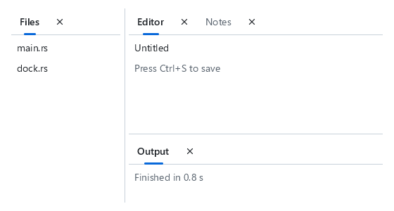

<!-- source: ja/23-dock.md fnv=1a7064548519bf33 -->
<!-- covers: Ui::dock DockArea::show DockArea::closable DockArea::grow Dock::new Dock::insert Dock::remove Dock::select Dock::panels Dock::selected Dock::contains Dock::is_floating Dock::save Dock::load sig=d6992f54a95c7ec7 -->
# Docking

`ui.dock(&mut dock)` arranges panels in tab groups. The user can drag a tab to another group or to an edge, drag the dividers to share the space, and float a panel over the other groups. It suits apps whose users arrange the window their own way, such as developer tools.

```rust
use kargui::{Dock, DockSide, DockTo};

#[derive(Clone, Copy, PartialEq, Hash)]
enum Panel { Files, Editor, Output }

let mut dock = Dock::new([Panel::Editor]);
dock.insert(Panel::Files, DockTo::Edge { side: DockSide::Left, share: 0.25 });
dock.insert(Panel::Output, DockTo::Split { of: Panel::Editor, side: DockSide::Bottom, share: 0.3 });
# kargui::test::example(|ui| {
let title = |p: &Panel| match p {
    Panel::Files => "Files",
    Panel::Editor => "Editor",
    Panel::Output => "Output",
}
.to_string();
ui.dock(&mut dock).grow().show(title, |ui, p| match p {
    Panel::Files => {
        ui.label("main.rs");
    }
    Panel::Editor => {
        ui.label("fn main() {}");
    }
    Panel::Output => {
        ui.label("Finished");
    }
});
# });
```



## The app keeps the layout

The layout lives in a `Dock<K>`. `K` is the app's name for a panel, such as the `enum` above, and needs `Clone`, `PartialEq` and `Hash`. kargui changes the `Dock` as the user rearranges the panels, so pass the same `Dock` in every frame.

A group is named by a panel in it, not by a number, so a place stays right while other panels move.

- `Dock::new(panels)` makes a layout with the panels as tabs of one group.
- `dock.insert(panel, place)` puts a panel somewhere; a panel already in the dock moves there. The place is a `DockTo`:
  - `DockTo::Tab { with, index }`: as a tab in the group of `with` (before `index`, or last with `None`)
  - `DockTo::Split { of, side, share }`: next to the group of `of`, splitting its space (`share` is the new panel's part)
  - `DockTo::Edge { side, share }`: along a side of the whole dock
  - `DockTo::Float { x, y, w, h }`: floating over the other groups (position from the dock's top-left corner and size, in logical pixels)
- `dock.remove(&panel)` takes a panel out. A group left empty disappears, and its neighbour takes its space.
- `dock.select(&panel)` selects a tab; `dock.panels()` and `dock.selected()` return the panels and the selected panel of each group. Floating groups come after the docked ones, the one at the back first. `dock.is_floating(&panel)` tells whether a panel is in a floating group.

## What the user can do

- Click a tab to select it. Dragging a tab more than 4 pixels starts moving it.
- While dragging, where the pointer is decides where the panel goes, and that place is shaded. There are no small targets to aim at.
  - The middle of a group's content: as a tab in that group
  - Within a quarter of the content's edge: split to that side (left, right, top or bottom)
  - Over a tab strip: between tabs
  - The bands along the left, right and bottom edges of the dock (20 pixels wide), and the band just below the top groups' tab strips: along that side of the whole dock (with two groups or more)
  - Over the group the dragged tab is alone in: nowhere (nothing is shaded, and dropping it changes nothing)
- Escape cancels.
- Drag a divider to share the space differently. Shares are kept as fractions, so they stay when the window is resized.
- Right-click a tab (or press Shift+F10 or the context menu key) for a menu: Move to a new group (Left, Right, Above, Below), Move into group, Float, and Close. A panel alone in its group moves to the outer edge of the dock.

People who find dragging hard, and screen-reader users, can do the same with the menu and the keyboard.

| Key | Does |
|---|---|
| Left, Right, Home, End (on a tab) | Select a tab in the group |
| Ctrl+Tab, Ctrl+PageDown (focus in the group) | Next tab (with Shift, or PageUp: previous tab) |
| Ctrl+Shift+PageUp, PageDown (on a tab) | Move the tab back (forward) |
| F6, Shift+F6 | Move the focus to the next (previous) group's tab (floating groups too, in the order they floated; the one reached comes to the top) |
| Delete (on a tab) | Close (with `.closable()`) |
| Arrow keys, Home, End (on a divider) | Move the divider |

Screen readers hear each group as a tab list with tabs and a tab panel, a floating group as a pane, and the dividers with their position in percent.

## Floating

Float in the tab's menu puts the panel in a frame over the other groups. Use it to keep a reference open while working in another panel.

- The frame opens in the middle of the dock; each further one is shifted a little.
- Drag the dots at the left of its tabs to move it, and the dots at its bottom-right corner to change its size. The pointer changes to the move and resize shapes.
- Pressing anywhere on a frame brings it to the top.
- What is under a frame cannot be pressed or scrolled there.
- Dropping another tab on a frame adds it as a tab. A frame is not split (one group per frame).
- Dock in the menu of a frame's tab puts the panel back where it was before it joined the frame (a tab dropped on the frame goes back to where it was dragged from), or along the right side if that place is gone. Dragging the tab onto another group works too.
- Frames stay inside the dock. When the window gets smaller they are shown pushed inside, and they go back when it grows again.

`dock.save` keeps the frames' positions and sizes. Where Dock puts a panel back is not saved, so after loading, Dock puts the first panel of a frame along the right side, and the frame's other panels then go into its group.

## Closing

`.closable()` gives each tab a close button (Close in the menu and Delete work too). kargui does not close the panel; `show` returns the panel the user wants to close, and the app takes it out with `dock.remove`. If there are unsaved changes, the app can ask first.

```rust
# use kargui::Dock;
# let mut dock = Dock::new(["Notes", "Draft"]);
# kargui::test::example(|ui| {
if let Some(p) = ui.dock(&mut dock).closable().grow().show(|p| p.to_string(), |ui, p| {
    ui.label(*p);
}) {
    dock.remove(&p);
}
# });
```

## Saving the layout

`dock.save(name)` turns the layout into text. Read it back with `Dock::load(text, panel)` at the next start. Names it does not know (panels the app no longer has) are left out, and groups left empty disappear. If the text is not a layout (for example, one saved by a newer kargui), it returns `None`; use your default layout then.

```rust
use kargui::Dock;

let dock = Dock::new(["Notes", "Draft"]);
let text = dock.save(|p| p.to_string());
let back = Dock::load(&text, |name| ["Notes", "Draft"].into_iter().find(|p| *p == name)).unwrap_or(dock.clone());
assert_eq!(back, dock);
```

## Not yet

Groups cannot be moved into separate windows yet (floating frames stay inside the window), and floating frames cannot be moved or resized with the keyboard yet. Hiding groups at the edges (auto-hide), named layouts and dragging a whole group are candidates for later versions.
