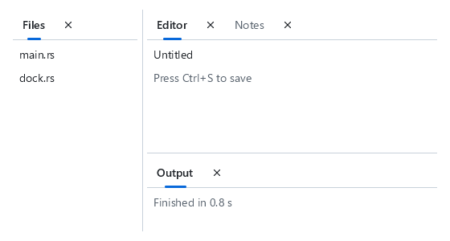

<!-- covers: Ui::dock DockArea::show DockArea::closable DockArea::grow Dock::new Dock::insert Dock::remove Dock::select Dock::panels Dock::selected Dock::contains Dock::is_floating Dock::save Dock::load sig=d6992f54a95c7ec7 -->
# ドッキング

`ui.dock(&mut dock)` は、パネルをタブのまとまりに入れて並べる部品です。利用者は、タブを引っ張ってほかのまとまりや端へ動かしたり、仕切りで広さを変えたり、パネルをほかのまとまりの上に浮かせたりできます。開発の道具のように、利用者が自分の使いやすい並べ方にするアプリに向いています。

```rust
use kargui::{Dock, DockSide, DockTo};

#[derive(Clone, Copy, PartialEq, Hash)]
enum Panel { Files, Editor, Output }

let mut dock = Dock::new([Panel::Editor]);
dock.insert(Panel::Files, DockTo::Edge { side: DockSide::Left, share: 0.25 });
dock.insert(Panel::Output, DockTo::Split { of: Panel::Editor, side: DockSide::Bottom, share: 0.3 });
# kargui::test::example(|ui| {
let title = |p: &Panel| match p {
    Panel::Files => "ファイル",
    Panel::Editor => "編集",
    Panel::Output => "出力",
}
.to_string();
ui.dock(&mut dock).grow().show(title, |ui, p| match p {
    Panel::Files => {
        ui.label("main.rs");
    }
    Panel::Editor => {
        ui.label("fn main() {}");
    }
    Panel::Output => {
        ui.label("終わりました");
    }
});
# });
```



## 並べ方はアプリが持つ

並べ方は `Dock<K>` が持ちます。`K` はパネルを指すアプリの値で、上の例の `enum` のように `Clone`・`PartialEq`・`Hash` を持つ物にします。kargui は利用者の操作に合わせて `Dock` を書き換えるので、アプリは同じ `Dock` を毎フレーム渡します。

まとまりは、中のパネルで指します。番号で指さないので、ほかのパネルが動いても指す先は変わりません。

- `Dock::new(パネル)` は、パネルを 1 つのまとまりのタブにした並べ方を作ります。
- `dock.insert(パネル, 置き場所)` は、パネルを置きます。もう入っているパネルなら、そこへ動かします。置き場所は `DockTo` で、次の 5 つです。
  - `DockTo::Tab { with, index }`: `with` のまとまりのタブにする（`index` の前。`None` は最後）
  - `DockTo::Split { of, side, share }`: `of` のまとまりを分けて、`side` 側に置く（`share` は新しい方の割合）
  - `DockTo::Edge { side, share }`: 全体の外側の `side` に置く
  - `DockTo::Float { x, y, w, h }`: ほかのまとまりの上に浮かせる（全体の左上からの位置と大きさ。論理ピクセル）
  - `DockTo::Window { x, y, w, h }`: OS の別の窓に出す（窓の外枠の左上の画面の上の位置と、中の大きさ）
- `dock.remove(&パネル)` は、パネルを外します。空になったまとまりは消え、隣のまとまりがその広さを取ります。
- `dock.select(&パネル)` はタブを選び、`dock.panels()` と `dock.selected()` は今のパネルと、まとまりごとの選んでいるパネルを返します。浮いたまとまりは、並べ方の木のまとまりの後に、下にある物から並びます。`dock.is_floating(&パネル)` は、パネルが浮いたまとまり（全体の中の枠か、別の窓）にあるかを返します。

## 利用者の操作

- タブを押すと選びます。タブを 4 画素より大きく引っ張ると、動かし始めます。
- 引っ張っている間は、ポインターのいる場所で落とす先が決まり、落ちる所が薄く塗られます。小さな的を狙う必要はありません。
  - まとまりの中身の真ん中: そのまとまりのタブにする
  - まとまりの中身の端から 4 分の 1 まで: 近い側（左・右・上・下）に分ける
  - 見出しの帯の上: タブの間に入れる
  - 全体の左・右・下の端の帯（幅 20 画素）と、上のまとまりの見出しの帯のすぐ下の帯: 全体の外側に置く（まとまりが 2 つ以上の時）
  - 引っ張っているタブだけのまとまりの上: 落とす先にならない（塗られず、落としても変わらない）
- Esc で取り消します。
- 仕切りを引くと広さが変わります。広さは割合で持つので、窓の大きさを変えても比が保たれます。
- タブを右クリックすると（Shift+F10 か、アプリのキーでも）、「新しいまとまりへ」（左・右・上・下）、「別のまとまりへ」、「浮かせる」、「新しい窓へ」、「閉じる」のメニューが出ます。まとまりに 1 つだけのパネルを「新しいまとまりへ」動かすと、全体の外側へ置きます。

メニューの文字は英語です（Move to a new group、Move into group、Float、Move to a new window、Dock、Close）。

引っ張るのが難しい人と読み上げソフトの人は、メニューとキーボードで同じことができます。

| キー | 働き |
|---|---|
| ←・→・Home・End（タブに焦点） | まとまりの中でタブを選ぶ |
| Ctrl+Tab・Ctrl+PageDown（まとまりの中に焦点） | 次のタブ（Shift か PageUp で前のタブ） |
| Ctrl+Shift+PageUp・PageDown（タブに焦点） | タブを前（後ろ）へ並べ替える |
| F6・Shift+F6 | 次（前）のまとまりのタブへ焦点を移す（浮いたまとまりも浮かせた順に回り、移った物をいちばん上にする） |
| Delete（タブに焦点） | 閉じる（`.closable()` の時） |
| ←→↑↓・Home・End（仕切りに焦点） | 仕切りを動かす |

読み上げソフトには、まとまりごとにタブの並び・タブ・タブの中身として伝わり、浮いたまとまりは区画（pane）、仕切りは位置を百分率で伝えます。

## 浮かせる

メニューの「浮かせる」（Float）で、パネルをほかのまとまりの上に重ねた枠に出せます。参考の資料を開いたまま、ほかのパネルで作業する時などに使います。

- 枠は全体の真ん中に出ます。2 つ目からは少しずつずらします。
- タブの左の点（⠿ の形）を引くと枠が動き、右下の点を引くと大きさが変わります。ポインターの形も、動かす形と広げる形に変わります。
- 枠のどこかを押すと、その枠がいちばん上になります。
- 枠の下の部品は、枠に隠れた所では押せず、ホイールも届きません。
- ほかのタブを枠の上に落とすと、枠のタブになります。枠は分けません（1 つの枠に 1 つのまとまり）。
- 枠のタブのメニューの「元の場所へ」（Dock）で、そのパネルが枠に入る前にいた所へ戻ります。後から枠へ落としたタブも、落とす前にいた所へ戻ります。そこが無くなっていれば、全体の右に置きます。枠のタブを引っ張って、ほかのまとまりへ落としても戻せます。
- 枠は全体の中に収めます。窓を小さくした時は内側へ寄せて見せ、窓を大きくすると元の場所に戻ります。

`dock.save` は枠の場所と大きさも保存します。「元の場所へ」で戻る先は保存しないので、読み直した後の「元の場所へ」は全体の右に置きます。同じ枠のほかのパネルは、その後は先に戻したパネルのまとまりへ入ります。

## 別の窓に出す

メニューの「新しい窓へ」（Move to a new window）で、パネルを OS の別の窓に出せます。画面が 2 つある時に、片方の画面へパネルを置く時などに使います。Windows と X11 で使えます。Wayland では、アプリが窓の場所を決めることも読むこともできないので、このメニューは出ません。

- 窓は、そのまとまりがあった所に、まとまりと同じ大きさで開きます。窓の題は、選んでいるパネルの題です。
- 窓の中のタブのメニューは、「元の場所へ」（Dock）・「別のまとまりへ」（Move into group）・「閉じる」です。ほかのまとまりのパネルも、メニューの「別のまとまりへ」で窓のまとまりへ入れられます。
- 窓を閉じると、中のパネルはそれぞれ、窓に入る前にいた所へ戻ります（パネルは消えません）。
- 窓の中のまとまりは分けません。窓をまたいでタブを引っ張ることも、まだできません。

窓の中身は、アプリの `App::window` が描きます。`dock.has_window(key)` が true の窓では、主の窓と同じように `ui.dock` を呼んでください。窓の中の `ui.dock` は、その窓のまとまりだけを窓いっぱいに描きます。

```rust
use kargui::{App, Dock, Ui};

struct Ide {
    dock: Dock<&'static str>,
}

impl Ide {
    fn panels(&mut self, ui: &mut Ui) {
        ui.dock(&mut self.dock).grow().show(|p| p.to_string(), |ui, p| {
            ui.label(*p);
        });
    }
}

impl App for Ide {
    fn view(&mut self, ui: &mut Ui) {
        self.panels(ui);
    }

    // 別の窓に出したまとまりも、同じ dock で描く
    fn window(&mut self, key: &str, ui: &mut Ui) {
        if self.dock.has_window(key) {
            self.panels(ui);
        }
    }
}
```

`dock.save` は、窓の場所（窓の外枠の左上。`Options::position` と同じ形）と中の大きさも保存します。利用者が窓を動かすと、保存する場所も変わります。Wayland で読み込んだ時は、窓のまとまりを全体の中の浮いた枠にします。

## 閉じる

`.closable()` を付けると、タブに閉じるボタンが付きます（メニューの「閉じる」と Delete も使えます）。kargui は閉じず、`show` が閉じたいパネルを返すだけです。アプリが `dock.remove` で外します。保存していない変更があれば、外す前に確かめられます。

```rust
# use kargui::Dock;
# let mut dock = Dock::new(["メモ", "下書き"]);
# kargui::test::example(|ui| {
if let Some(p) = ui.dock(&mut dock).closable().grow().show(|p| p.to_string(), |ui, p| {
    ui.label(*p);
}) {
    dock.remove(&p);
}
# });
```

## 並べ方を保存する

`dock.save(名前)` は、並べ方を文字にします。次に起動した時に `Dock::load(文字, 戻し方)` で戻します。知らない名前（アプリから無くなったパネル）は捨てられ、空になったまとまりは消えます。文字の形が違う時（kargui の新しい版で保存した物など）は `None` を返すので、決まった並べ方に戻してください。

```rust
use kargui::Dock;

let dock = Dock::new(["メモ", "下書き"]);
let text = dock.save(|p| p.to_string());
let back = Dock::load(&text, |name| ["メモ", "下書き"].into_iter().find(|p| *p == name)).unwrap_or(dock.clone());
assert_eq!(back, dock);
```

## まだ無いこと

窓をまたいでタブを引っ張ることと、浮いた枠を窓の外へ引っ張って別の窓にすることは、まだできません。浮いた枠をキーボードで動かす・大きさを変えることも、まだできません。端に隠す（オートハイド）、名前を付けた並べ方、まとまりごと引っ張ることも、後の版の候補です。
