# Widgets

Generated by `cargo run -p xtask -- shots`. Light and dark mode, 100% scale.

## label

## button

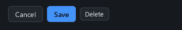

## checkbox

## toggle

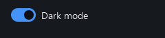

## segmented

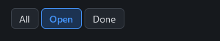

## text_input

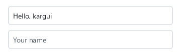

## text_input_ime

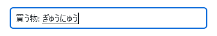

## list

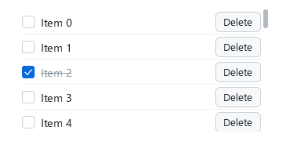
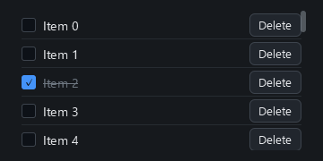

## list_selection

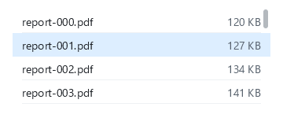

## slider

## scroll

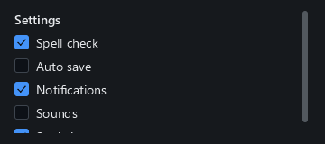

## disabled

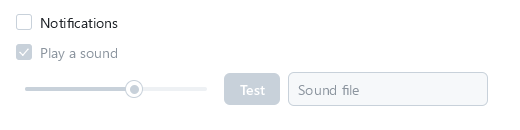

## popup

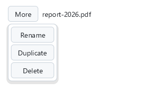
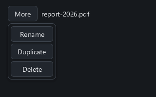

## dialog

## text_area

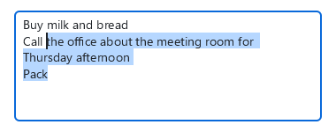

## text_area_ime

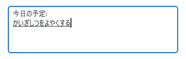
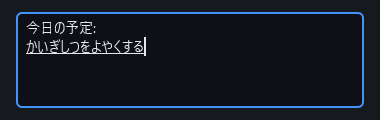

## icons

## image

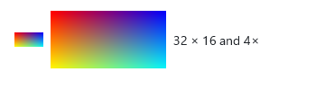

## tooltip

