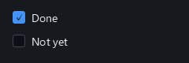
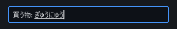
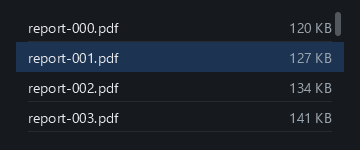
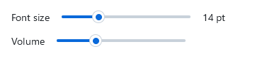
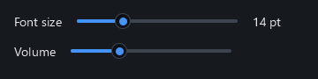
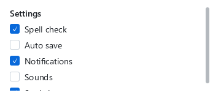

# Widgets

Generated by `cargo run -p xtask -- shots`. Light and dark mode, 100% scale.

## label

## button

## checkbox

## toggle

## segmented

## text_input

## text_input_ime

## list

## list_selection

## slider

## scroll

