# Widgets

Generated by `cargo run -p xtask -- shots`. Light and dark mode, 100% scale.

## label

## button

## checkbox

## toggle

## segmented

## text_input

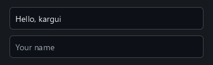

## text_input_ime

## list

## list_selection

## slider

## scroll

## disabled

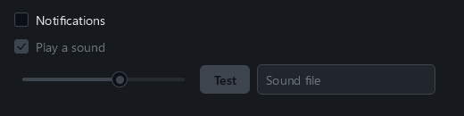

## popup

## dialog

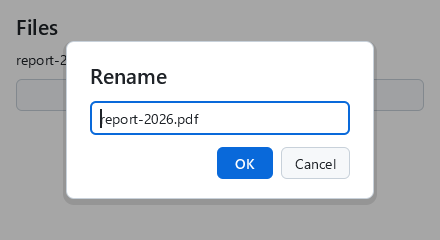
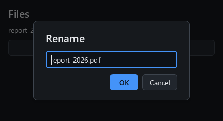

## text_area

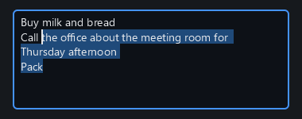

## text_area_ime

## dropdown

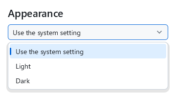
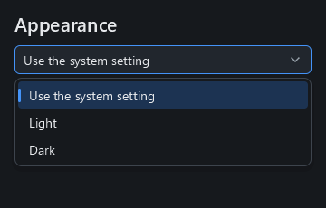

## menus

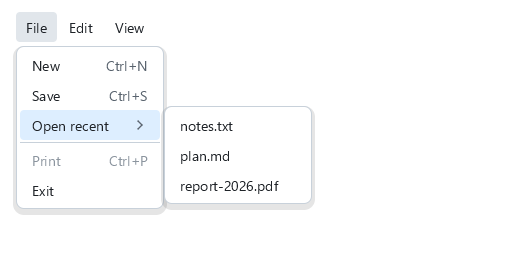
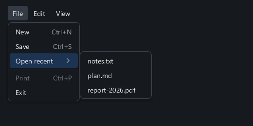

## context_menu

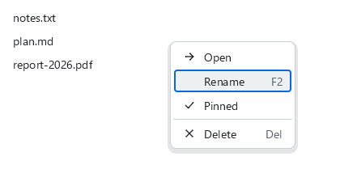
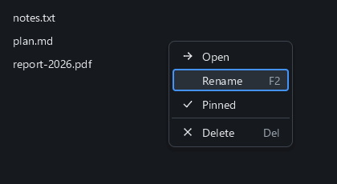

## tabs

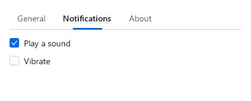
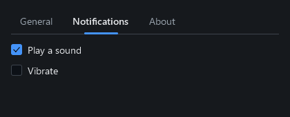

## toolbar

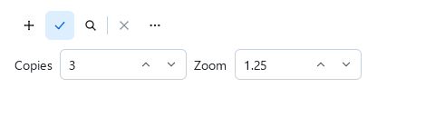
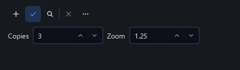

## grid_split

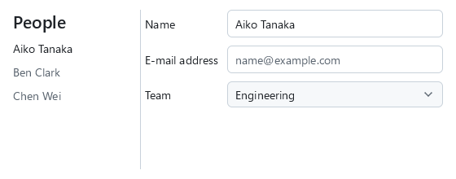
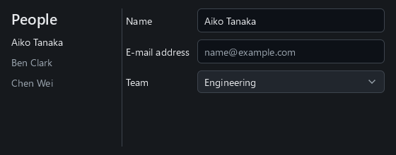

## canvas

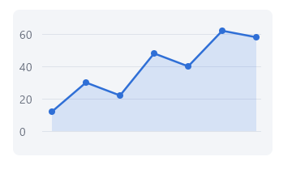
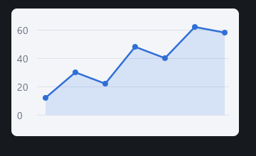

## drag_and_drop

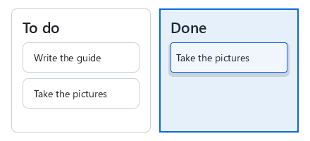
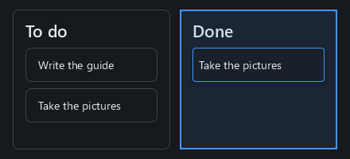

## tree

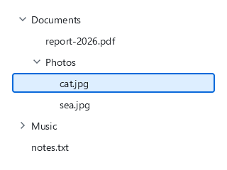
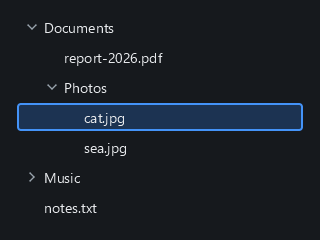

## table

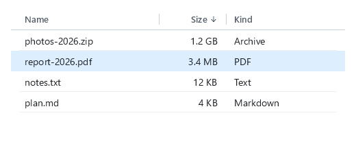
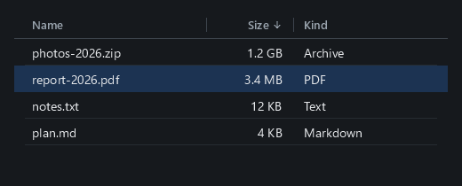

## date_picker

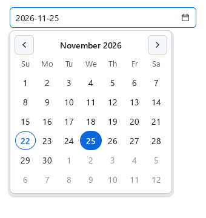
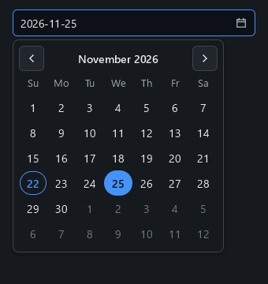

## time_picker

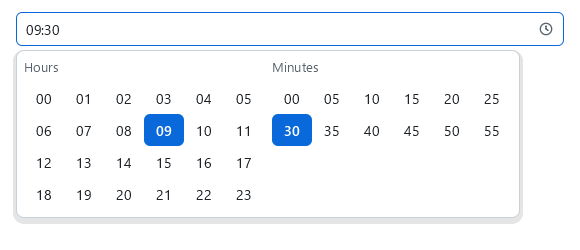
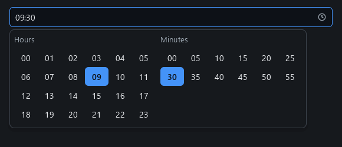

## color_picker

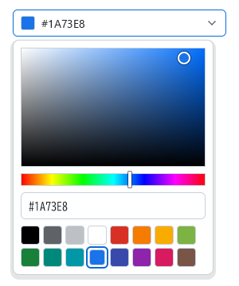
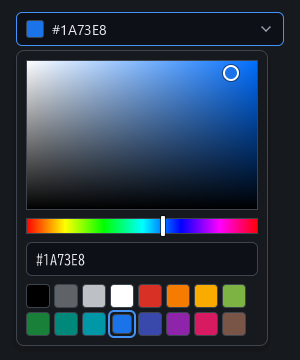

## rich_text

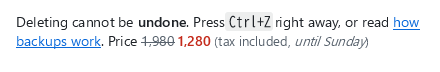

## more_widgets

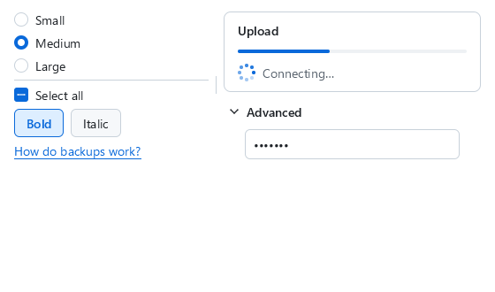
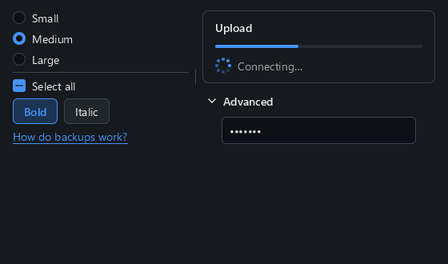

## icons

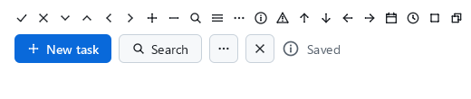
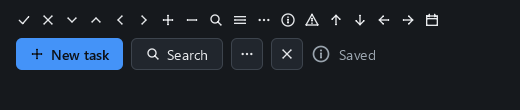

## image

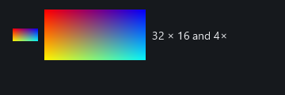

## tooltip

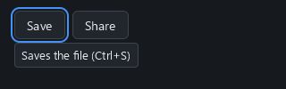

